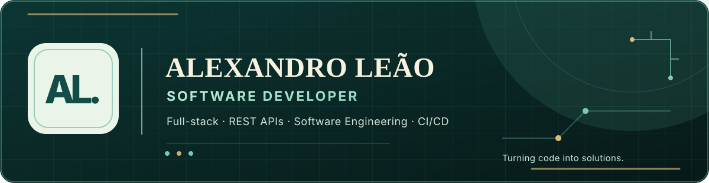

  

  

    
    
    
    
  

## Core stack

  

<strong>Frontend</strong> · <strong>REST APIs</strong> · <strong>Databases</strong> · <strong>Software Engineering</strong> · <strong>CI/CD</strong>

## About

I'm a **Software Developer** with a degree in **Systems Analysis and Development**. I enjoy turning real problems into useful applications, from responsive web interfaces to authenticated REST APIs and persistent data.

I value thoughtful architecture, automated testing, accessibility, technical documentation, and continuous improvement. I'm currently deepening my knowledge of **backend development, Java, cloud computing, and software engineering**.

## Selected projects

**[Developer Portfolio](https://github.com/AlexandroLeao/developer-portfolio)** · [Live site](https://alexandroleao.com.br/)  
A bilingual, responsive React/TypeScript portfolio with automated tests, SEO, accessibility improvements, and GitHub Actions/Vercel CI/CD. Achieved **100/100 across all four Lighthouse categories in a production audit**.

**[Adventure Files](https://github.com/AlexandroLeao/rpg-character-creator)** · [Live app](https://adventure-files-staging.vercel.app/)  
A retro-inspired full-stack RPG character creator with a six-stage flow, eight classes, PNG exports, Node.js/Express REST API, Supabase Auth, PostgreSQL, and RLS. Includes frontend, API, and database security tests; the hosted frontend received **grade A on SecurityHeaders.com**.

**[Ideas & Projects Organizer](https://github.com/AlexandroLeao/app-project-ideias)** · [Live app](https://app-project-ideias.vercel.app/)  
A React/TypeScript productivity app for organizing ideas and projects with priorities, categories, filters, favorites, and progress tracking.

**[Natsu Matsuri Project](https://github.com/AlexandroLeao/Natsu-Matsuri-Project)** · [Live app](https://alexandroleao.github.io/Natsu-Matsuri-Project/)  
A React/JavaScript financial tracking system designed around event sales, transactions, and balance monitoring.

Explore my background, experience, technical details, and additional work at **[alexandroleao.com.br](https://alexandroleao.com.br/)**.

## Engineering highlights

- **Quality and performance:** achieved **100/100 in all four Lighthouse categories** during a production audit of my portfolio, with responsive images, optimized local fonts, accessibility improvements, and SEO metadata.
- **Full-stack delivery:** built Adventure Files from its bilingual React interface to its authenticated Express API, PostgreSQL persistence, and user-scoped Row Level Security policies.
- **Automated validation:** developed and maintained **35 portfolio tests** and comprehensive Adventure Files suites covering **180 frontend tests**, **107 API test cases** (including two optional integration cases), and database security checks.
- **Security and documentation:** Adventure Files received a **SecurityHeaders.com grade A** in a hosted check; my projects document architecture and workflows with UML diagrams, requirements, and technical decisions.
- **Development workflow:** use Issues, feature branches, Pull Requests, GitHub Actions, and deployment previews to review changes before production releases.

## GitHub activity

  
  

<em>Transformando código em soluções.</em>

