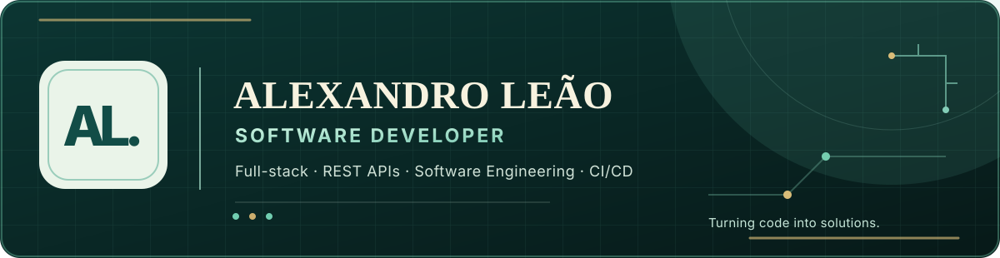
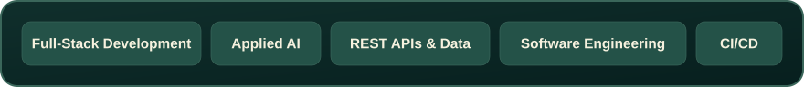
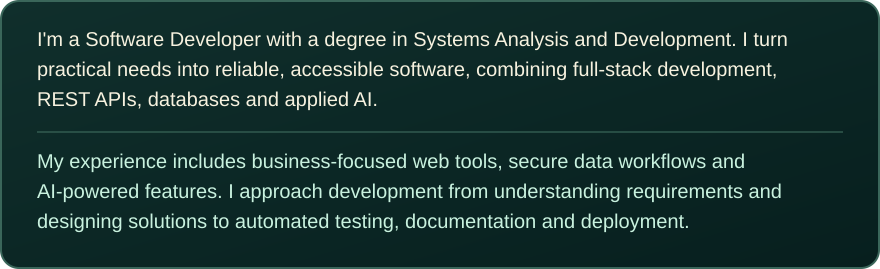
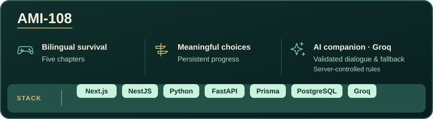
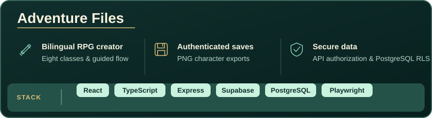
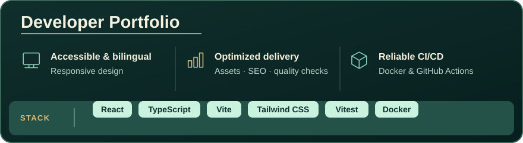

  

  

    
    
    
    
  

  

## CORE STACK

  

  <picture>
    <source media="(max-width: 600px)" srcset="./assets/core-focus-mobile.svg" />
    
  </picture>

  

## ABOUT

  <picture>
    <source media="(max-width: 600px)" srcset="./assets/about-card-mobile.svg" />
    
  </picture>

  

## FEATURED PROJECTS

  <a href="https://ami-108.vercel.app/game">
    <picture>
      <source media="(max-width: 600px)" srcset="./assets/projects/ami-108-mobile.svg" />
      
    </picture>
  </a>

  <a href="https://adventure-files-staging.vercel.app/">
    <picture>
      <source media="(max-width: 600px)" srcset="./assets/projects/adventure-files-mobile.svg" />
      
    </picture>
  </a>

  <a href="https://alexandroleao.com.br/">
    <picture>
      <source media="(max-width: 600px)" srcset="./assets/projects/developer-portfolio-mobile.svg" />
      
    </picture>
  </a>

  

## GITHUB ACTIVITY

  
  

  

  <picture>
    <source media="(max-width: 600px)" srcset="./assets/sections/signature-mobile.svg" />
    
  </picture>

